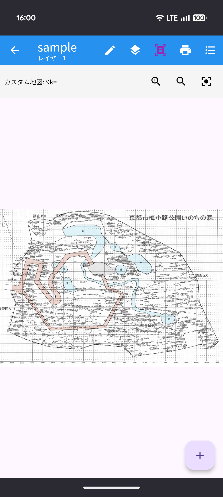
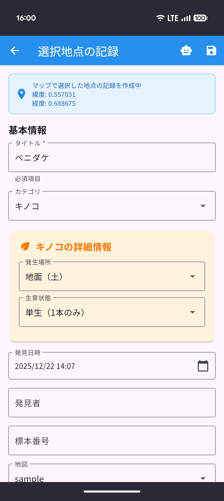
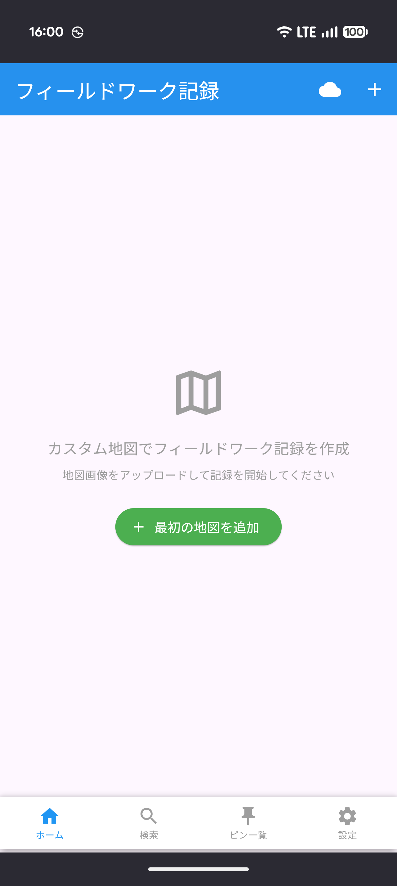
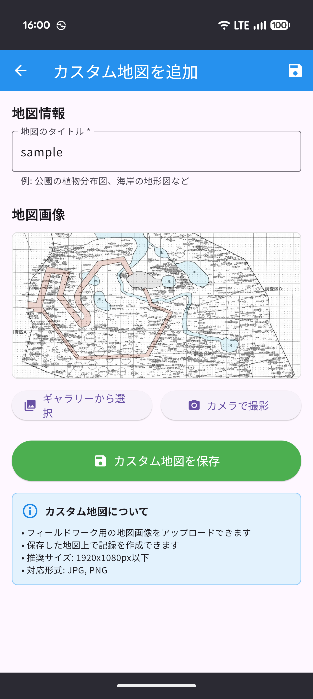

# 位置メモ - フィールドワーク記録アプリ

フィールドワーク等野外調査の記録を効率化するメモアプリです。
画像として取り込んだ地図上にピンを置いてメモを作成します。ピンには文字だけでなく、写真や音声を添付できます。

  
  

## できること

- 地図画像上にピンを配置し、メモを作成
- 複数枚の写真や音声メモを添付
- カテゴリ・発見者・標本番号等の詳細情報を付与
- PDFや画像ファイルとして出力、印刷
- 登録なしでローカル保存を開始し、必要な場合だけクラウド同期・共有
- 画像・音声を含むバックアップv2と、既存バックアップv1の復元

## 提供方式

| プラットフォーム | 配布方法 | 備考 |
|---|---|---|
| Android | Google Play向けAAB | Android 7.0（API 24）以上、target SDK 36 |
| Web | PWA（<https://akiii2024.github.io/location_memo/>） | JavaScriptビルド、オフライン利用対応 |

iOS、Wasm、AIバックエンドは次段階の対象です。

## インストール方法
[インストールガイド](https://akiii2024.github.io/location_memo_guide/)を参照してください。アクセスするデバイスにより最適な方法が表示されます。

## アプリの使い方
1. 地図を追加

アプリを開き、ホーム画面の「最初の地図を追加」から地図画像を選択します。ログインは不要です。

  
  

2. ピンを配置してメモ作成

地図を開き、記録したい位置をタップ。タイトルや詳細情報、写真・音声を登録

  

3. バックアップ・印刷・クラウド共有を利用

設定からバックアップを作成・復元できます。調査結果はPDFで出力でき、クラウド同期や共同編集を選んだ時だけログイン画面を開きます。

## 主な機能
 - 地図管理（複数の地図を切り替え）
 - レイヤー機能（１つの地図に複数のレイヤーを作成）
 - 情報つきメモ（カテゴリ・標本番号など様々な情報を添付可）
 - 画像・音声の添付
 - 検索とフィルタ（地図別・カテゴリ別など）
 - 印刷機能（地図画像、ピンリスト、PDF出力）
 - バックアップと復元（データの安全な保存と復旧）

## システム要件

### 対応デバイス・OS

#### Android
- **OSバージョン**: Android 7.0（API 24）以上
- **インストール方法**: APKファイルまたはPWA（プログレッシブウェブアプリ）

#### Web（PC・タブレット）
- **正式対象**: Flutter WebのJavaScriptビルド
- **アクセスURL**: https://akiii2024.github.io/location_memo/
- **PWA対応**: ブラウザからホーム画面にインストール可能

### 必要な機能・権限

- **カメラ**: 写真撮影・画像添付機能に必要
- **マイク**: 音声メモ録音機能に必要
- **アプリ内ストレージ**: 地図画像・写真・音声ファイルをアプリ専用領域へ保存
- **インターネット接続**: 
  - 基本的な機能（地図表示・メモ作成・編集）はオフラインでも利用可能
  - クラウド同期・共同編集・Firebase認証にはインターネット接続が必要

### 推奨環境

- **ストレージ容量**: 地図画像や写真の保存に応じた空き容量が必要（目安：数百MB以上）
- **メモリ**: スムーズな動作のため、十分な空きメモリを推奨
- **画面サイズ**: スマートフォン・タブレット・PCの各種画面サイズに対応

### 注意事項

- 公開版のAI機能は、APIキー漏えい防止のため安全なバックエンド移行まで無効です
- AI機能を公開する場合は、APIキーをアプリへ埋め込まず、安全なバックエンド経由で提供する必要があります
- 大容量の画像ファイルを扱う場合、端末のメモリ容量によっては処理に時間がかかる場合があります
- オフライン環境でも基本的な機能は利用できますが、クラウド同期と共同編集はオンライン時のみ利用可能です

### プライバシーとアカウント削除

- [プライバシーポリシー](https://akiii2024.github.io/location_memo/privacy.html)
- [アカウント削除案内](https://akiii2024.github.io/location_memo/account-deletion.html)
- 公開前の残作業は [RELEASE_CHECKLIST.md](RELEASE_CHECKLIST.md) を確認してください

### 開発時の確認

- Flutter 3.35.3 / Dart 3.9.2 / Temurin JDK 17 / Gradle 8.9 / AGP 8.7.2
- `flutter analyze`、単体・Widgetテスト、Firebase Emulatorルールテスト
- Webリリースビルド、署名付きAndroid App Bundle

実機・ストア公開前に必要な確認項目は [RELEASE_CHECKLIST.md](RELEASE_CHECKLIST.md) にまとめています。
